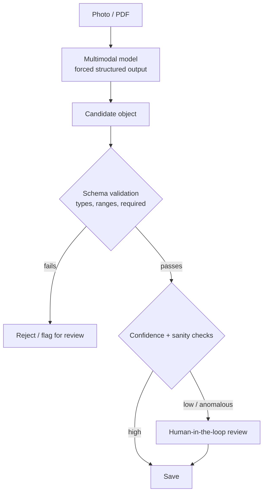
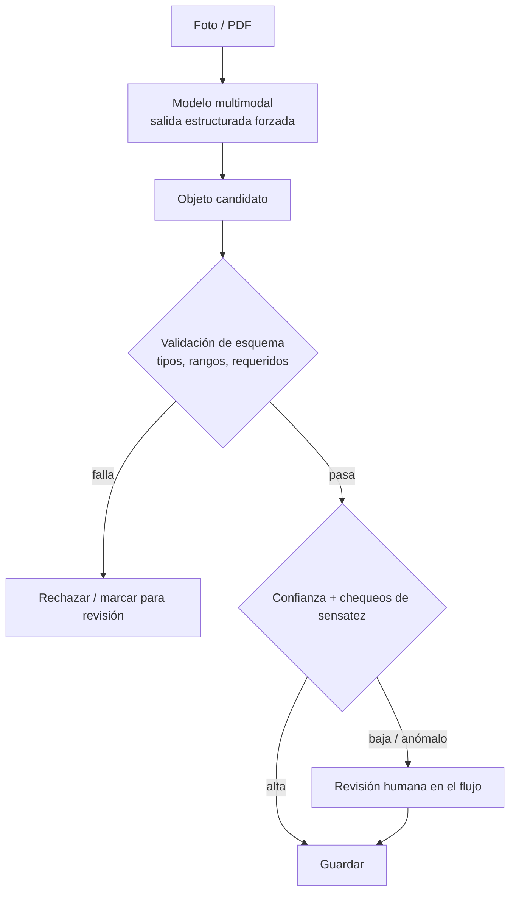

"Just OCR it" is where a lot of document-AI projects go to die. The hard part was never reading the characters — modern multimodal models do that well. The hard part is turning a photo of a form, a report, or an invoice into **structured, validated data your system can trust**, and knowing when *not* to trust it.

## Ask for a schema, not prose

The single biggest upgrade is to stop asking the model for a description and start asking it to fill a **schema**. Multimodal models support forced tool use / structured output: you hand the image and a strict field definition, and the model must return an object that matches it. No free text to parse, no "the value is approximately…". You define the shape; the model fills it.

## Validate on the way in

The model's output is a *candidate*, not a fact. Run it through a real validator (I use Zod) before anything downstream touches it: correct types, values within plausible ranges, required fields present, dates that parse, totals that add up. A field that fails validation should never be silently coerced — it should be rejected or flagged. Validation is also your defense against the model "helpfully" inventing a value it could not actually read.

## Keep a human in the loop where it counts

Full autonomy is the wrong default for anything consequential. The pattern that works: the model proposes the structured fields, the person **reviews and confirms** before they are saved. Done right this is fast — the human is correcting the occasional field, not typing everything — and it keeps a person accountable for what enters the system. Reserve straight-through, no-review processing for cases where a wrong value is cheap to undo.

## Confidence and sanity checks decide the path

Not every extraction needs the same scrutiny. Use cheap signals to route:

- **Cross-field consistency** — do the line items sum to the total? Does the date fall in a sensible window?
- **Missing or ambiguous fields** — if a required field is empty or the image was blurry, send it to review.
- **Out-of-distribution values** — a number three orders of magnitude off is a red flag, not a fact.

High-confidence, internally-consistent extractions can flow through; anything doubtful gets a human. This is how you get both speed and safety instead of choosing one.

## Operational details that save you

- **Store the source alongside the extraction.** Keep the original image/PDF linked to the record so any value can be re-checked against what was actually submitted.
- **Version your schema and prompt.** When you tighten a field, you want to know which extractions predate the change.
- **Redact and mind privacy.** Documents often carry personal data; strip or protect what you do not need, and be deliberate about what leaves your infrastructure.
- **Log token and cost per job.** Per-document cost tracking turns "is this feature worth it?" into a number.

Reliable document AI is less about the model and more about the **contract around it**: a strict schema in, validation and sanity checks in the middle, a human where the stakes are high, and the original always one click away. Get that contract right and "snap a photo" becomes data you can build on.

<!--===ES===-->

"Solo pásale OCR" es donde muchos proyectos de document-AI van a morir. La parte difícil nunca fue leer los caracteres —los modelos multimodales lo hacen bien—. La parte difícil es convertir la foto de un formulario, un informe o una factura en **datos estructurados, validados y confiables para tu sistema**, y saber cuándo *no* confiar en ellos.

## Pide un esquema, no prosa

La mejora más grande es dejar de pedirle al modelo una descripción y empezar a pedirle que llene un **esquema**. Los modelos multimodales soportan uso forzado de herramientas / salida estructurada: le entregas la imagen y una definición estricta de campos, y el modelo debe devolver un objeto que la cumpla. Nada de texto libre que parsear, nada de "el valor es aproximadamente…". Tú defines la forma; el modelo la llena.

## Valida en la entrada

La salida del modelo es un *candidato*, no un hecho. Pásala por un validador real (yo uso Zod) antes de que algo aguas abajo la toque: tipos correctos, valores en rangos plausibles, campos requeridos presentes, fechas que parsean, totales que cuadran. Un campo que no valida no debe coercionarse en silencio: debe rechazarse o marcarse. La validación es también tu defensa contra que el modelo "ayude" inventando un valor que en realidad no pudo leer.

## Mantén un humano en el flujo donde importa

La autonomía total es el default equivocado para cualquier cosa con consecuencias. El patrón que funciona: el modelo propone los campos estructurados y la persona los **revisa y confirma** antes de guardarlos. Bien hecho es rápido —el humano corrige un campo ocasional, no escribe todo— y mantiene a una persona responsable de lo que entra al sistema. Reserva el procesamiento directo sin revisión para casos donde un valor equivocado sea barato de deshacer.

## La confianza y los chequeos deciden el camino

No toda extracción necesita el mismo escrutinio. Usa señales baratas para enrutar:

- **Consistencia entre campos:** ¿los ítems suman el total? ¿la fecha cae en una ventana razonable?
- **Campos faltantes o ambiguos:** si un requerido está vacío o la imagen salió borrosa, va a revisión.
- **Valores fuera de distribución:** un número tres órdenes de magnitud fuera es una alerta, no un dato.

Las extracciones de alta confianza y consistentes pueden fluir; lo dudoso pasa por un humano. Así obtienes velocidad y seguridad en vez de elegir una.

## Detalles operativos que te salvan

- **Guarda la fuente junto a la extracción.** Mantén la imagen/PDF original enlazada al registro para poder re-verificar cualquier valor contra lo que realmente se envió.
- **Versiona tu esquema y tu prompt.** Cuando endurezcas un campo, querrás saber qué extracciones son previas al cambio.
- **Redacta y cuida la privacidad.** Los documentos suelen traer datos personales; elimina o protege lo que no necesites, y sé deliberado con lo que sale de tu infraestructura.
- **Registra tokens y costo por trabajo.** El costo por documento convierte "¿vale la pena esta función?" en un número.

El document-AI confiable se trata menos del modelo y más del **contrato a su alrededor**: un esquema estricto a la entrada, validación y chequeos de sensatez en el medio, un humano donde el riesgo es alto, y el original siempre a un clic. Acierta ese contrato y "toma una foto" se vuelve datos sobre los que puedes construir.
