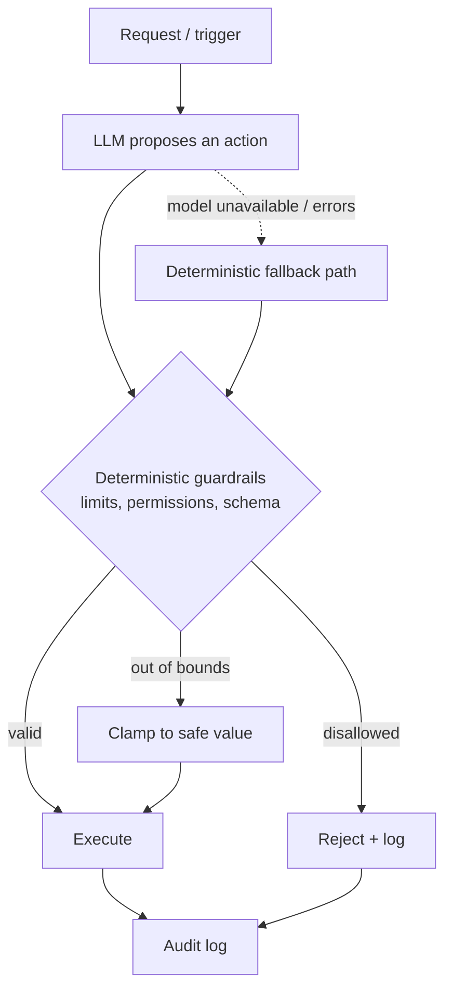
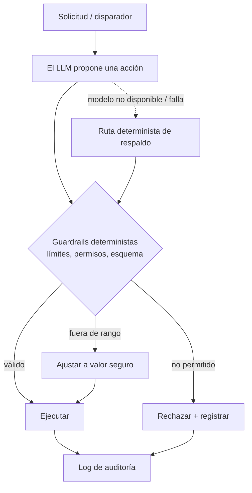

The moment you let a language model *do* things — call tools, move money, change records, act autonomously — a design question becomes unavoidable: what happens when the model is wrong? Because it will be wrong, and prompt injection means an attacker can *make* it wrong on purpose. My rule for anything agentic is simple: **LLMs propose, deterministic code disposes.**

## The model is an advisor, not the authority

Treat the model as a brilliant, fast, occasionally reckless advisor. It proposes an action; it never gets to be the last word. Between the proposal and the effect sits a layer of **plain, tested, deterministic code** that enforces the rules that must always hold. Limits, permissions, sizes, quotas, allowed targets — these live in code, not in a prompt. No amount of clever wording, jailbreak, or injected instruction can widen a limit that is checked by a function the model cannot reach.

## What belongs in the deterministic layer

- **Hard limits.** Maximums, minimums, rate and spend caps. The model can suggest a number; the code decides whether it is allowed, and clamps or rejects it otherwise.
- **Permissions and scope.** Who is acting, on what, and are they allowed. Never delegate authorization to the model.
- **Schema and types.** Force tool arguments through a strict schema (I use Zod on the way in). A proposal that does not parse never runs.
- **Idempotency and money math.** Use exact decimal arithmetic and idempotency keys so a retried or duplicated proposal cannot double-apply.

## Fail closed, and always have a deterministic fallback

Two properties make agentic systems safe to operate. **Fail closed:** if a guardrail cannot evaluate, the action does not happen. **Deterministic fallback:** when the model is slow, unavailable, or returns garbage, the system falls back to a coded path that produces a safe, predictable outcome instead of blocking or guessing. The feature degrades; it does not misbehave.

## Make every decision reproducible

Log the full chain for every action: the input, the model's proposal, which guardrail fired, the final decision, and the effect. Two benefits follow. First, incidents become explainable — you can replay exactly why something happened. Second, you can **backtest**: reuse the same runtime against historical inputs to see how a change would have behaved before you ship it. If replaying the past changes the outcome non-deterministically, you have a bug hiding in your "deterministic" layer.

## Why this beats "just prompt it better"

It is tempting to encode the rules in the system prompt — "never exceed X", "only touch the user's own data". That is a suggestion, not a control. Prompts are probabilistic and injectable; a function that returns `reject` is neither. Put guidance in the prompt to improve the *quality* of proposals, and put the rules that must never break in code that the model cannot argue with.

Agentic systems are worth building — they automate real work. They are only worth *operating* when the blast radius of a wrong or hijacked proposal is bounded by code you control. Let the model be creative. Let the code be in charge.

<!--===ES===-->

En el momento en que dejas que un modelo de lenguaje *haga* cosas —invocar herramientas, mover dinero, cambiar registros, actuar de forma autónoma— surge una pregunta de diseño ineludible: ¿qué pasa cuando el modelo se equivoca? Porque se va a equivocar, y la inyección de prompts significa que un atacante puede *hacer* que se equivoque a propósito. Mi regla para cualquier cosa agéntica es simple: **los LLM proponen, el código determinista decide.**

## El modelo es un asesor, no la autoridad

Trata al modelo como un asesor brillante, rápido y a veces imprudente. Propone una acción; nunca tiene la última palabra. Entre la propuesta y el efecto va una capa de **código simple, probado y determinista** que hace cumplir las reglas que siempre deben mantenerse. Límites, permisos, tamaños, cuotas, destinos permitidos: viven en código, no en un prompt. Ninguna redacción astuta, jailbreak o instrucción inyectada puede ampliar un límite que valida una función a la que el modelo no llega.

## Qué va en la capa determinista

- **Límites duros.** Máximos, mínimos, topes de frecuencia y de gasto. El modelo puede sugerir un número; el código decide si se permite, y lo ajusta o rechaza.
- **Permisos y alcance.** Quién actúa, sobre qué y si está autorizado. Nunca delegues la autorización al modelo.
- **Esquema y tipos.** Fuerza los argumentos de las herramientas por un esquema estricto (yo uso Zod en la entrada). Una propuesta que no parsea, no corre.
- **Idempotencia y aritmética monetaria.** Usa decimales exactos y claves de idempotencia para que una propuesta reintentada o duplicada no se aplique dos veces.

## Falla cerrado, y ten siempre un respaldo determinista

Dos propiedades hacen seguros de operar a los sistemas agénticos. **Falla cerrado:** si un guardrail no puede evaluar, la acción no ocurre. **Respaldo determinista:** cuando el modelo está lento, caído o devuelve basura, el sistema cae a una ruta codificada que produce un resultado seguro y predecible en vez de bloquearse o adivinar. La función se degrada; no se descontrola.

## Haz reproducible cada decisión

Registra la cadena completa de cada acción: la entrada, la propuesta del modelo, qué guardrail se activó, la decisión final y el efecto. Se siguen dos beneficios. Primero, los incidentes se vuelven explicables: puedes reproducir exactamente por qué pasó algo. Segundo, puedes hacer **backtesting**: reutilizar el mismo runtime contra entradas históricas para ver cómo se habría comportado un cambio antes de desplegarlo. Si reproducir el pasado cambia el resultado de forma no determinista, tienes un bug escondido en tu capa "determinista".

## Por qué esto le gana a "solo mejora el prompt"

Es tentador codificar las reglas en el system prompt: "nunca excedas X", "solo toca los datos del propio usuario". Eso es una sugerencia, no un control. Los prompts son probabilísticos e inyectables; una función que devuelve `reject` no lo es. Pon la guía en el prompt para mejorar la *calidad* de las propuestas, y pon las reglas que nunca deben romperse en código con el que el modelo no pueda discutir.

Los sistemas agénticos valen la pena: automatizan trabajo real. Solo valen la pena *de operar* cuando el radio de daño de una propuesta equivocada o secuestrada está acotado por código que tú controlas. Deja que el modelo sea creativo. Deja que el código mande.
