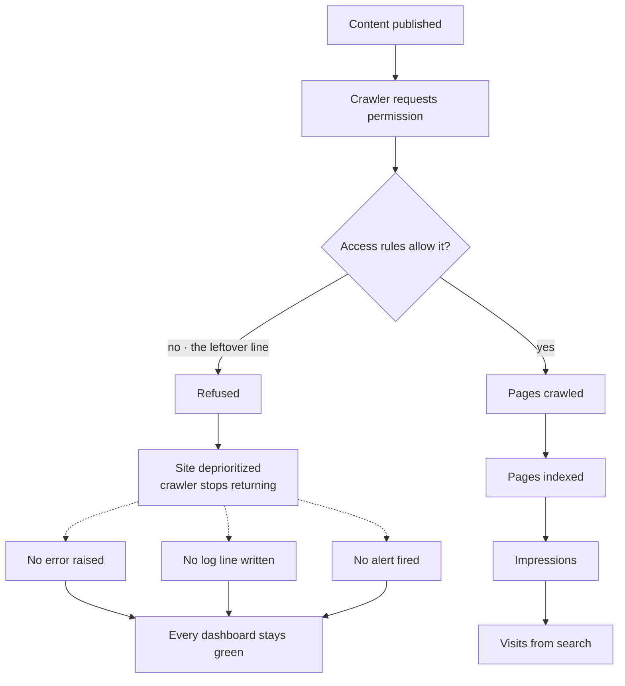
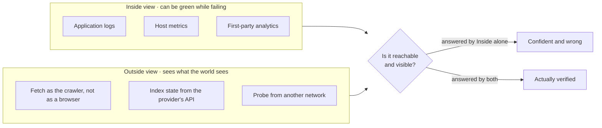
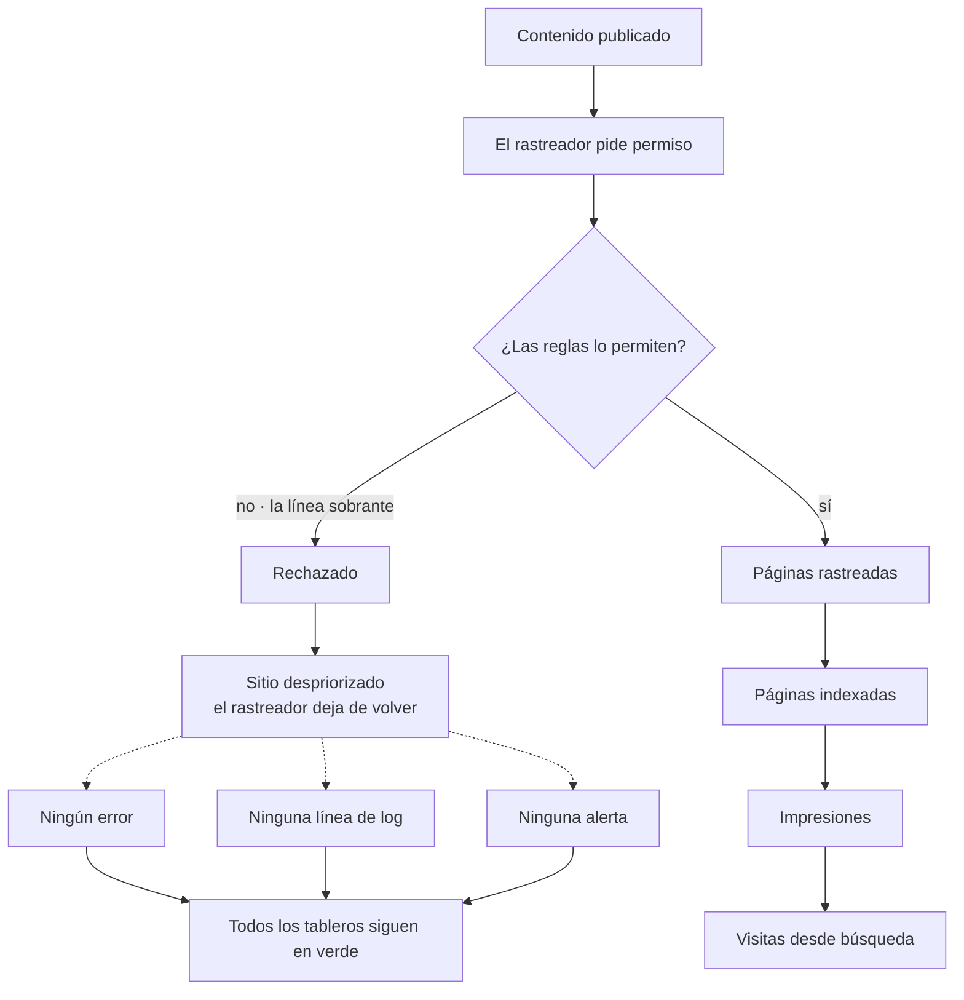
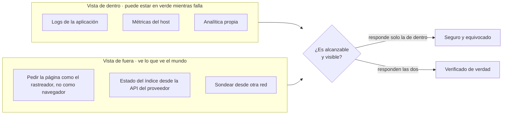

Nothing was down. The server answered every request, the dashboards were green, the error logs were empty. And for three months, no search engine read a single line of anything I published.

The cause was one line in a configuration file, left over from development: a rule telling crawlers to stay out. Correct while the site was being built. Forgotten the day it went live.

## The failure that produces no symptom

Most outages announce themselves. A process dies, a request times out, a status code turns red, something in the chain raises its hand. This one raised nothing, because nothing was broken. The server was doing exactly what it had been told to do: politely turning crawlers away.

That is the whole difficulty of this class of bug. There is no error to log, no threshold to cross, no alert to fire. Every instrument on the dashboard is measuring correctly, and every instrument is measuring the wrong thing.

Development artifacts that survive into production are common enough: a feature flag, a seeded row, a permissive default. Most of them eventually announce themselves by misbehaving in front of a user. The ones that quietly block a channel you are **not using yet** stay silent until you need that channel, and by then the silence has had months to look normal.

## Zero is a signal, and a different one from "few"

Analytics for a young site look like a slow start: a handful of visits, mostly direct, plus whatever comes from links you shared yourself. Organic search sitting at zero reads as "it's early".

But low organic traffic and *no* organic traffic are not the same measurement. Low is competitive — you are in the index and ranking badly. Zero is usually structural — you are not in the index at all. The first is fixed by writing better. The second is not fixed by writing at all, which is exactly what makes it expensive: you keep producing into a channel that is closed, and the cost compounds quietly with every article.

The trap is that your own analytics cannot tell you which situation you are in. First-party analytics measures the people who arrived. It is, by construction, silent about everyone who never could.

## Why it does not repair itself

I had corrected the file weeks before I understood there was a problem. That changed nothing, for two reasons worth knowing in advance.

**Crawlers back off.** When one is refused, it does not keep retrying out of optimism. It deprioritizes the site and returns rarely. A domain with no inbound links offers no other reason to come back. The fix sits there, correct and unread, for as long as it takes.

**The recorded state goes stale.** The last crawl attempt is a fact frozen at the moment it happened. Months later the report still describes the world as it was that day. If you read it as current status, you will conclude you are still blocked when you are not, or that your fix failed when it never got tested.

Fixing the file and fixing the outcome are two different jobs. The second one needs an explicit push: hand over a machine-readable map of the site and ask, deliberately, to be looked at again.

## The view from outside

The general lesson has nothing to do with search engines.

**Every system needs at least one check performed from somewhere it does not control.** Monitoring that runs on the host it monitors cannot report that the host died. Analytics that runs inside the application cannot report that the application is unreachable. A health check that asks a service whether it feels well will always get an answer, and an answer is not the same thing as the truth.

## What I check now, on anything I ship

- **Fetch the site as the crawler identifies itself**, not as a browser. Different user agents get different answers far more often than people expect — a bot filter, a challenge page, a redirect that only fires for one of them.
- **Read the index state from the provider's own API.** It reports what the other side believes about you, which is the only view that matters for that channel. Your analytics cannot see it.
- **Submit the machine-readable map explicitly.** Discovery by luck is not a strategy for a domain nobody links to yet.
- **Treat visibility as a monitored property with a floor.** Zero indexed pages for a site that should have twenty is an alert, not a statistic. Same for zero impressions across a whole week.
- **After a fix, verify from outside that the state actually moved.** A corrected file is not a corrected outcome, and the gap between them can be months.

The uncomfortable part was never the mistake. A leftover line in a config file is an ordinary mistake, and it will happen again in some other form. What is worth sitting with is that a system can be healthy by every measure you chose, and still be failing completely at the one thing it exists to do. The instruments were not broken. They were pointed inward.

<!--===ES===-->

Nada estaba caído. El servidor respondía todas las peticiones, los tableros en verde, los registros de error vacíos. Y durante tres meses ningún buscador leyó una sola línea de lo que publiqué.

La causa era una línea en un archivo de configuración, sobrante del desarrollo: una regla que le pedía a los rastreadores que no entraran. Correcta mientras se construía el sitio. Olvidada el día que salió a producción.

## El fallo que no produce ningún síntoma

Casi todas las caídas se anuncian. Un proceso muere, una petición expira, un código de estado se pone en rojo, algo en la cadena levanta la mano. Esta no levantó nada, porque nada estaba roto. El servidor hacía exactamente lo que se le había dicho: rechazar rastreadores con toda educación.

Ahí está toda la dificultad de esta clase de error. No hay error que registrar, ni umbral que cruzar, ni alerta que disparar. Todos los instrumentos del tablero miden bien, y todos miden lo que no era.

Los artefactos de desarrollo que sobreviven hasta producción son bastante comunes: un interruptor de función, una fila sembrada, un valor por defecto demasiado permisivo. La mayoría termina delatándose al portarse mal delante de un usuario. Los que bloquean en silencio un canal que **todavía no estás usando** se quedan callados hasta que necesitas ese canal, y para entonces el silencio lleva meses pareciendo normal.

## Cero es una señal, y distinta de "pocos"

La analítica de un sitio joven parece un arranque lento: unas pocas visitas, casi todas directas, más lo que llega de los enlaces que compartiste tú. Que la búsqueda orgánica marque cero se lee como "es pronto".

Pero poco tráfico orgánico y *ningún* tráfico orgánico no son la misma medición. Poco es competitivo: estás en el índice y posicionas mal. Cero suele ser estructural: no estás en el índice en absoluto. Lo primero se arregla escribiendo mejor. Lo segundo no se arregla escribiendo, y eso es justo lo que lo vuelve caro: sigues produciendo hacia un canal cerrado, y el costo se acumula en silencio con cada artículo.

La trampa es que tu propia analítica no puede decirte en cuál de las dos estás. La analítica propia mide a quienes llegaron. Por construcción, calla sobre todos los que nunca pudieron.

## Por qué no se arregla solo

Yo había corregido el archivo semanas antes de entender que había un problema. Eso no cambió nada, por dos razones que conviene saber de antemano.

**Los rastreadores se repliegan.** Cuando a uno lo rechazan, no sigue reintentando por optimismo. Despriorizan el sitio y vuelven rara vez. Un dominio sin enlaces entrantes no les da ninguna otra razón para regresar. El arreglo se queda ahí, correcto y sin leer, el tiempo que haga falta.

**El estado registrado se vuelve viejo.** El último intento de rastreo es un hecho congelado en el momento en que ocurrió. Meses después el informe sigue describiendo el mundo como era ese día. Si lo lees como estado actual, vas a concluir que sigues bloqueado cuando ya no lo estás, o que tu arreglo falló cuando en realidad nunca se puso a prueba.

Arreglar el archivo y arreglar el resultado son dos trabajos distintos. El segundo necesita un empujón explícito: entregar un mapa del sitio legible por máquina y pedir, a propósito, que te vuelvan a mirar.

## La vista desde fuera

La lección general no tiene nada que ver con los buscadores.

**Todo sistema necesita al menos una comprobación hecha desde algún lugar que no controla.** El monitoreo que corre en la misma máquina que vigila no puede avisar de que esa máquina murió. La analítica que vive dentro de la aplicación no puede avisar de que la aplicación es inalcanzable. Un chequeo de salud que le pregunta a un servicio si se siente bien siempre obtiene una respuesta, y una respuesta no es lo mismo que la verdad.

## Lo que compruebo ahora en todo lo que despliego

- **Pedir el sitio como se identifica el rastreador**, no como un navegador. Distintos agentes reciben respuestas distintas mucho más seguido de lo que uno espera: un filtro de bots, una página de desafío, una redirección que solo se activa para uno de los dos.
- **Leer el estado del índice desde la API del propio proveedor.** Informa lo que el otro lado cree sobre ti, que es la única vista que importa para ese canal. Tu analítica no puede verlo.
- **Enviar el mapa legible por máquina de forma explícita.** El descubrimiento por suerte no es una estrategia para un dominio que todavía nadie enlaza.
- **Tratar la visibilidad como una propiedad vigilada con un mínimo.** Cero páginas indexadas en un sitio que debería tener veinte es una alerta, no una estadística. Lo mismo para cero impresiones en una semana entera.
- **Después de un arreglo, verificar desde fuera que el estado se movió.** Un archivo corregido no es un resultado corregido, y entre los dos puede haber meses.

Lo incómodo nunca fue el error. Una línea sobrante en un archivo de configuración es un error ordinario, y volverá a pasar de alguna otra forma. Lo que vale la pena masticar es que un sistema puede estar sano según todas las medidas que elegiste y aun así estar fallando por completo en lo único para lo que existe. Los instrumentos no estaban rotos. Estaban apuntando hacia dentro.
