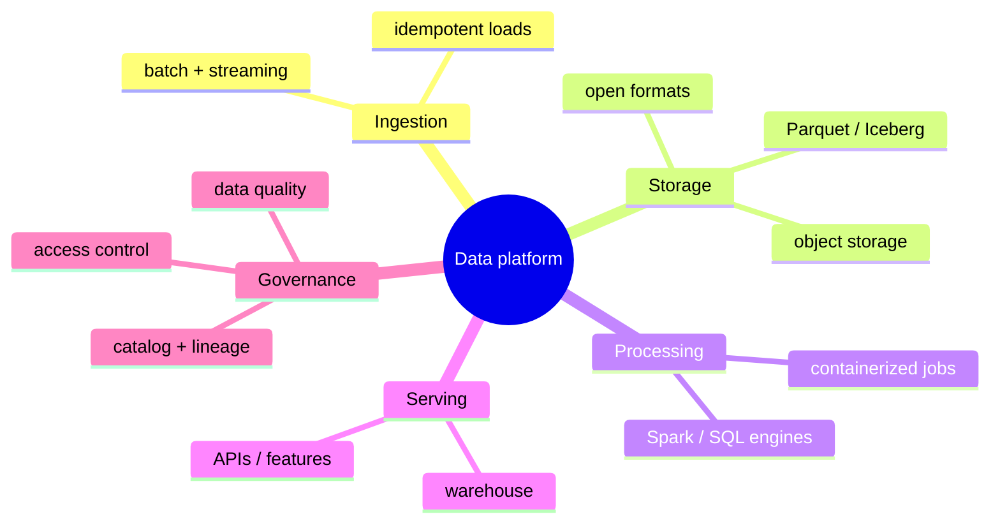
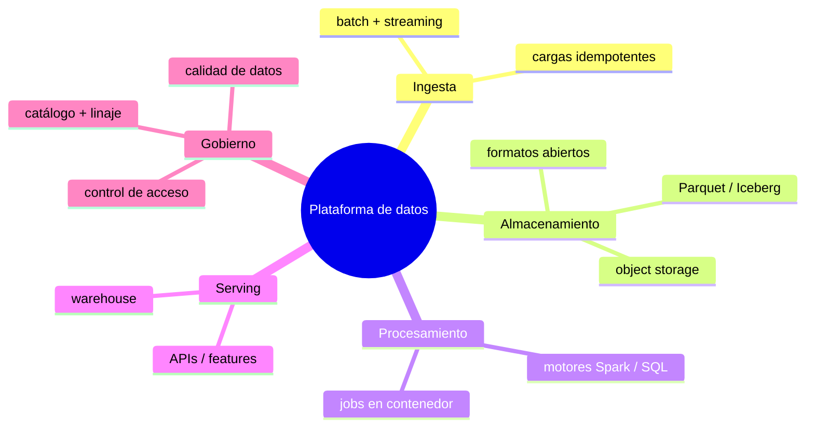

"Multi-cloud" is sold as resilience and negotiating leverage. Done carelessly it becomes the opposite: three half-learned platforms, duplicated pipelines, and a team that can't reason about where data actually lives. After building data platforms across the major clouds, my take is that multi-cloud is worth it — but only if you pay attention to *where* you couple to a vendor and *where* you stay portable.

## Portability lives in the seams, not everywhere

Trying to make everything cloud-agnostic is how you end up with a lowest-common-denominator platform that is worse than any single cloud. The pragmatic move is to be deliberate: use each cloud's managed services where they earn their keep, and keep **portable seams** at the boundaries so you are never trapped.

## The portable core

- **Open table and file formats.** Store the source of truth as open formats (Parquet, and a table format like Iceberg/Delta) on object storage. This is the single highest-leverage decision — your data outlives any one engine, and multiple clouds can read it.
- **Containerized, declarative processing.** Package transformations as containers and orchestrate them with tooling that runs anywhere. SQL-first transforms keep logic portable and reviewable.
- **Infrastructure as code.** Provision with Terraform so an environment is reproducible and a second region or cloud is a config change, not a project.

## Where vendor lock-in is fine

Not all lock-in is bad. Managed warehouses, serverless compute, and identity are where the clouds add real value and switching rarely pays off. Couple to them **on purpose**, behind a boundary, and write down the exit cost. Lock-in you chose with eyes open is a decision; lock-in you drifted into is a liability.

## Governance is the part people skip — and regret

The failure mode of multi-cloud is not technical, it is **governance**. When data spreads across platforms, you need a single answer to: what data exists, where did it come from, who can touch it, and is it any good. That means a **catalog and lineage** that span clouds, **access control** enforced consistently, and **data-quality checks** that run in the pipelines rather than in someone's head. Frameworks like DAMA and TOGAF are useful here less as certifications and more as a shared vocabulary for making these responsibilities explicit.

## Standardize MLOps once, run it anywhere

If models train on this data, the same principle applies: standardize the *practice* — experiment tracking, model registry, reproducible training, CI/CD for models — and keep the implementation portable enough to run on whichever cloud hosts a given workload. A model that can only be retrained on the cloud it was born on is its own kind of lock-in.

## A simple test

Before adopting a second cloud, ask: *if this vendor doubled its price tomorrow, what would it cost me to leave?* If the honest answer for your source data is "a weekend", you built it right. If it is "a rewrite", your portability is theoretical. Multi-cloud pays off when the data is portable, the governance is unified, and the vendor coupling is a series of deliberate choices — not an accident you discover during an outage.

<!--===ES===-->

El "multi-cloud" se vende como resiliencia y poder de negociación. Hecho sin cuidado se vuelve lo contrario: tres plataformas a medio aprender, pipelines duplicados y un equipo que no puede razonar sobre dónde viven realmente los datos. Tras construir plataformas de datos en las nubes principales, mi postura es que el multi-cloud vale la pena, pero solo si prestas atención a *dónde* te acoplas a un proveedor y *dónde* te mantienes portable.

## La portabilidad vive en las costuras, no en todos lados

Intentar que todo sea agnóstico a la nube es cómo terminas con una plataforma de mínimo común denominador, peor que cualquier nube individual. Lo pragmático es ser deliberado: usa los servicios administrados de cada nube donde valen la pena, y mantén **costuras portables** en las fronteras para no quedar atrapado.

## El núcleo portable

- **Formatos abiertos de tabla y archivo.** Guarda la fuente de verdad en formatos abiertos (Parquet, y un formato de tabla como Iceberg/Delta) sobre object storage. Es la decisión de mayor apalancamiento: tus datos sobreviven a cualquier motor, y varias nubes pueden leerlos.
- **Procesamiento declarativo en contenedores.** Empaqueta las transformaciones como contenedores y orquéstalas con herramientas que corran en cualquier lado. Transformaciones SQL-first mantienen la lógica portable y revisable.
- **Infraestructura como código.** Aprovisiona con Terraform para que un entorno sea reproducible y una segunda región o nube sea un cambio de config, no un proyecto.

## Dónde el lock-in está bien

No todo el lock-in es malo. Los warehouses administrados, el cómputo serverless y la identidad son donde las nubes aportan valor real y cambiarse rara vez conviene. Acóplate a ellos **a propósito**, detrás de una frontera, y anota el costo de salida. El lock-in que elegiste con los ojos abiertos es una decisión; el que adquiriste a la deriva es un pasivo.

## El gobierno es la parte que la gente salta — y lamenta

La falla del multi-cloud no es técnica, es de **gobierno**. Cuando los datos se dispersan entre plataformas, necesitas una sola respuesta a: qué datos existen, de dónde vienen, quién puede tocarlos y si son buenos. Eso significa un **catálogo y linaje** que abarquen nubes, **control de acceso** aplicado de forma consistente y **chequeos de calidad de datos** que corran en los pipelines y no en la cabeza de alguien. Marcos como DAMA y TOGAF sirven aquí menos como certificaciones y más como vocabulario común para hacer explícitas estas responsabilidades.

## Estandariza el MLOps una vez, córrelo donde sea

Si hay modelos que entrenan sobre estos datos, aplica el mismo principio: estandariza la *práctica* —tracking de experimentos, registro de modelos, entrenamiento reproducible, CI/CD para modelos— y mantén la implementación lo bastante portable para correr en la nube que aloje cada carga. Un modelo que solo puede reentrenarse en la nube donde nació es su propia forma de lock-in.

## Una prueba simple

Antes de adoptar una segunda nube, pregunta: *si este proveedor duplicara su precio mañana, ¿cuánto me costaría irme?* Si la respuesta honesta para tus datos fuente es "un fin de semana", lo construiste bien. Si es "una reescritura", tu portabilidad es teórica. El multi-cloud rinde cuando los datos son portables, el gobierno está unificado y el acoplamiento al proveedor es una serie de decisiones deliberadas, no un accidente que descubres durante una caída.
