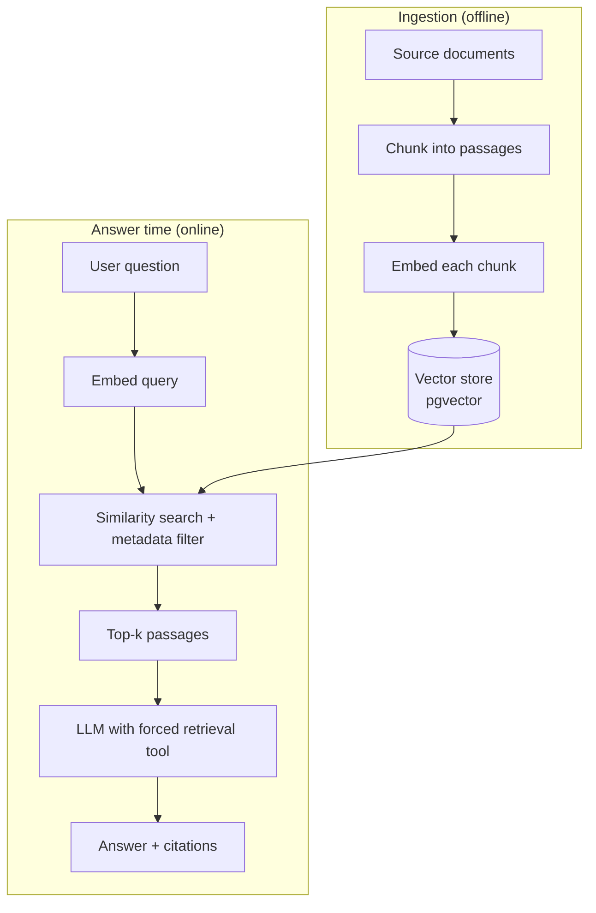
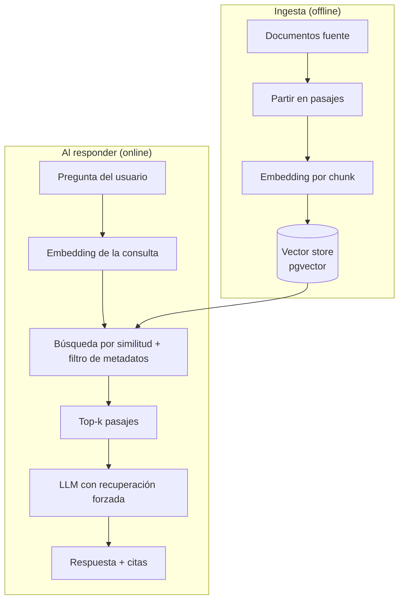

A general-purpose model answers from what it memorized. That is fine for trivia and terrible for anything that depends on *your* facts — a customer's history, a document someone uploaded five minutes ago, the current state of a record. The fix is not a bigger model; it is **retrieval-augmented generation (RAG)** done well: ground every answer in your own data and make the model **cite** what it used.

## Why grounding and citations matter

Two failure modes sink most "AI assistant" features. The first is **confident hallucination**: the model invents a plausible answer with no basis. The second is **staleness**: it answers from training data instead of the record in front of the user. Grounding solves both by injecting the relevant, current source text into the prompt at answer time. Citations then make the answer *auditable* — the reader can click through to the paragraph the claim came from, and you can measure whether the model actually used the sources.

## The pipeline

## Chunking and embeddings

Retrieval quality is decided long before the model runs. Split documents into passages that are **self-contained** (a few hundred tokens, respecting headings and paragraph boundaries) so each chunk carries enough context to stand alone. Attach metadata to every chunk — owner, document id, date, section — because the fastest way to improve relevance is not a better embedding model, it is a **filter** that removes everything that could not possibly be relevant.

Store the vectors next to your relational data. Postgres with `pgvector` lets you run the similarity search and the metadata `WHERE` clause in one query, keep everything transactional, and avoid running a second database just for embeddings.

## Retrieval as a tool, not a hope

The reliable pattern is to make retrieval a **tool the model is forced to call** before it may answer, rather than stuffing context in and hoping. The model issues a search, receives the top passages, and composes an answer *from them*. Ask it to return the passage ids it relied on, render those as links, and you have citations for free. If retrieval returns nothing useful, the correct behavior is to say "I don't have that" — a grounded system should refuse rather than improvise.

## Scope everything

If your data belongs to many owners, the scope filter is also a **security boundary**. Every retrieval must be constrained to the current user's or tenant's records; a leaked passage from someone else's data is a data breach, not a relevance bug. Bake the scope into the query, not into the prompt.

## Practical tips

- **Tune k and chunk size together.** Too few chunks miss context; too many bury the answer and cost tokens.
- **Filter before you rank.** Metadata filters are cheaper and more reliable than hoping the vector search sorts it out.
- **Evaluate retrieval separately from generation.** Measure "did we fetch the right passage?" before blaming the model.
- **Cache embeddings** keyed by content hash so re-ingesting the same document is free.

Grounded, cited answers are the difference between a demo and something people trust with real decisions. The model is the easy part; the retrieval around it is where the quality lives.

<!--===ES===-->

Un modelo de propósito general responde desde lo que memorizó. Sirve para trivia y falla en todo lo que dependa de *tus* datos: el historial de un cliente, un documento que alguien subió hace cinco minutos, el estado actual de un registro. La solución no es un modelo más grande, es **generación aumentada por recuperación (RAG)** bien hecha: anclar cada respuesta a tus propios datos y hacer que el modelo **cite** lo que usó.

## Por qué importan el anclaje y las citas

Dos fallas hunden a la mayoría de las funciones de "asistente con IA". La primera es la **alucinación con seguridad**: el modelo inventa una respuesta plausible sin ninguna base. La segunda es la **desactualización**: responde desde sus datos de entrenamiento en vez del registro que el usuario tiene enfrente. El anclaje resuelve ambas inyectando el texto fuente relevante y actual en el prompt al momento de responder. Las citas hacen la respuesta *auditable*: el lector puede ir al párrafo del que salió la afirmación, y tú puedes medir si el modelo realmente usó las fuentes.

## El pipeline

## Chunking y embeddings

La calidad de la recuperación se decide mucho antes de que corra el modelo. Divide los documentos en pasajes **autocontenidos** (unos cientos de tokens, respetando encabezados y párrafos) para que cada chunk lleve suficiente contexto por sí solo. Adjunta metadatos a cada chunk —dueño, id de documento, fecha, sección— porque la forma más rápida de mejorar la relevancia no es un mejor modelo de embeddings, es un **filtro** que descarte todo lo que no podría ser relevante.

Guarda los vectores junto a tus datos relacionales. Postgres con `pgvector` te deja correr la búsqueda por similitud y el `WHERE` de metadatos en una sola consulta, mantener todo transaccional y evitar una segunda base de datos solo para embeddings.

## La recuperación como herramienta, no como esperanza

El patrón confiable es hacer que la recuperación sea una **herramienta que el modelo está obligado a invocar** antes de poder responder, en vez de meter contexto y cruzar los dedos. El modelo lanza una búsqueda, recibe los pasajes top y compone la respuesta *a partir de ellos*. Pídele que devuelva los ids de los pasajes que usó, renderízalos como enlaces y tienes citas gratis. Si la recuperación no trae nada útil, lo correcto es decir "no tengo eso": un sistema anclado debe negarse antes que improvisar.

## Delimita todo

Si tus datos pertenecen a muchos dueños, el filtro de alcance es también una **frontera de seguridad**. Cada recuperación debe restringirse a los registros del usuario o tenant actual; un pasaje filtrado de los datos de otro es una fuga, no un bug de relevancia. Codifica el alcance en la consulta, no en el prompt.

## Consejos prácticos

- **Ajusta k y el tamaño de chunk juntos.** Muy pocos chunks pierden contexto; demasiados entierran la respuesta y cuestan tokens.
- **Filtra antes de rankear.** Los filtros de metadatos son más baratos y confiables que esperar que la búsqueda vectorial lo resuelva.
- **Evalúa la recuperación aparte de la generación.** Mide "¿trajimos el pasaje correcto?" antes de culpar al modelo.
- **Cachea embeddings** por hash de contenido para que re-ingerir el mismo documento sea gratis.

Las respuestas ancladas y citadas son la diferencia entre un demo y algo en lo que la gente confía para decisiones reales. El modelo es la parte fácil; la calidad vive en la recuperación que lo rodea.
