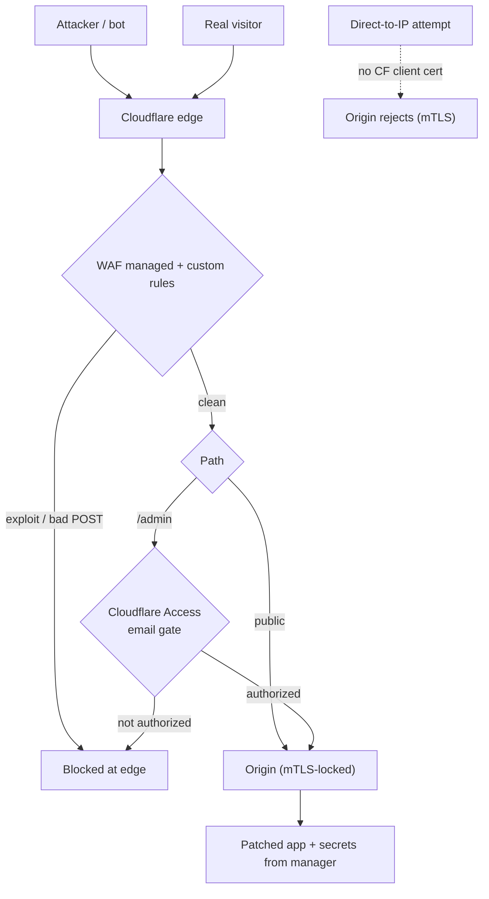
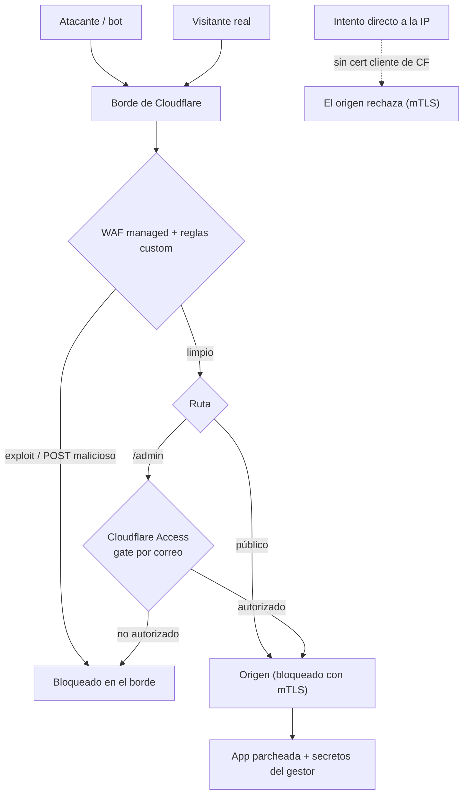

A production Next.js app I run got hit by a real remote code execution — not a scan, an actual exploit that ran code on the server and read its environment. This is the honest write-up: what happened, how I found it, and the layered defense I put up afterward. The most important lesson up front: **patching the app is the fix; everything else is a layer that buys you margin.**

## What happened

The vulnerability was a React Server Components deserialization RCE (the "React2Shell" class, CVE-2025-55182) affecting a range of Next.js versions. The exploit sends a crafted server-action / RSC payload to `/`; the server deserializes it, executes attacker code, and — in this case — dumped `process.env` back inside an error `digest` that gets returned to the client. Decoded, that payload contained every secret the process held: database URL and password, session secret, and API keys.

The tell was in the container logs: repeated errors with a large compressed `digest`. Decompressing one revealed a system-fingerprint plus the full environment. That confirmed it wasn't a probe — code had run, and secrets were gone.

## Step 1: patch, then rotate

Order matters. First, **upgrade to the patched version** — no WAF rule substitutes for closing the actual hole. Then treat every secret the process could see as **compromised** and rotate them: database password, session secret (critical — with it an attacker can forge an admin session), and every API key. Secrets that only the provider can revoke (third-party API keys) have to be revoked *at the provider*; changing your `.env` does nothing until you do.

## Step 2: shrink what a future RCE can reach

An in-process RCE reads whatever the app can read. You cannot fully prevent that while the app is running, but you can shrink the blast radius:

- **Move secrets out of a plaintext `.env`** into a secrets manager injected at boot. A leak now exposes one revocable, audited token instead of every key.
- **Harden the container**: read-only root filesystem, drop all Linux capabilities, `no-new-privileges`, and writable `tmpfs` only where strictly needed. A dropped miner has nowhere to persist.
- **Hide the framework version** so scanners can't fingerprint you as easily.

## Step 3: layered defense at the edge

Then I put the app behind Cloudflare and locked the origin so the edge can't be bypassed.

Each layer does one job. **WAF** blocks known exploit patterns (the managed ruleset even had a rule for this exact CVE) plus a custom rule for suspicious POSTs. **Access** puts the admin panel behind an email-verified gate *before* the request reaches the app. **Origin lock** via Authenticated Origin Pulls (mTLS) means the origin only accepts connections carrying Cloudflare's client certificate — so an attacker who finds the raw server IP can't skip the WAF by hitting it directly. Restore the real client IP behind the proxy so rate limits and logs stay meaningful.

## The honest limit

None of the edge layers "fix" an RCE. If the app process is exploitable and holds a secret in memory, code running *as the app* can read it. That is exactly why the patch is non-negotiable and why secrets management reduces — but does not eliminate — exposure. Defense in depth is about making the attacker's job harder at every step and shrinking what a single failure can cost, not about a magic wall.

## What proved it worked

After patching, the same exploit kept arriving from dozens of cloud IPs — and produced zero code-execution errors. At the edge, the firewall log was wall-to-wall blocks; at the origin, the raw IP started returning connection failures to anything without Cloudflare's certificate. The attack didn't stop (internet background radiation never does); it just stopped mattering.

Takeaways: watch your logs, keep dependencies patched (I wired up automated dependency PRs so I never sit on a known CVE again), rotate fast and completely when secrets leak, and build in layers so the day something slips through, it lands on the next wall instead of your data.

<!--===ES===-->

Una app Next.js en producción que administro sufrió un RCE real —no un escaneo, un exploit de verdad que ejecutó código en el servidor y leyó su entorno—. Esta es la crónica honesta: qué pasó, cómo lo encontré y la defensa en capas que levanté después. La lección más importante primero: **parchear la app es la solución; todo lo demás es una capa que te da margen.**

## Qué pasó

La vulnerabilidad fue un RCE por deserialización de React Server Components (la clase "React2Shell", CVE-2025-55182) que afecta a un rango de versiones de Next.js. El exploit envía un payload de server-action / RSC a `/`; el servidor lo deserializa, ejecuta código del atacante y —en este caso— volcó `process.env` dentro de un `digest` de error que se devuelve al cliente. Descodificado, ese payload contenía todos los secretos del proceso: URL y contraseña de la base de datos, secreto de sesión y claves de API.

La señal estaba en los logs del contenedor: errores repetidos con un `digest` comprimido grande. Descomprimir uno reveló una huella del sistema más todo el entorno. Eso confirmó que no era una sonda: código había corrido, y los secretos se habían ido.

## Paso 1: parchear, luego rotar

El orden importa. Primero, **actualizar a la versión parcheada**: ningún regla de WAF sustituye cerrar el agujero real. Luego tratar cada secreto que el proceso pudo ver como **comprometido** y rotarlos: contraseña de la base de datos, secreto de sesión (crítico —con él un atacante puede falsificar una sesión de admin—) y cada clave de API. Los secretos que solo el proveedor puede revocar (claves de API de terceros) hay que revocarlos *en el proveedor*; cambiar tu `.env` no hace nada hasta que lo hagas.

## Paso 2: reducir lo que un futuro RCE puede alcanzar

Un RCE en proceso lee lo que la app puede leer. No puedes evitarlo del todo mientras la app corre, pero sí reducir el radio de daño:

- **Saca los secretos de un `.env` plano** a un gestor de secretos inyectado al arranque. Una fuga ahora expone un solo token revocable y auditado, en vez de todas las claves.
- **Endurece el contenedor**: sistema de archivos de solo lectura, quitar todas las capabilities de Linux, `no-new-privileges` y `tmpfs` escribible solo donde sea estrictamente necesario. Un minero dropeado no tiene dónde persistir.
- **Oculta la versión del framework** para que los escáneres no te identifiquen tan fácil.

## Paso 3: defensa en capas en el borde

Después puse la app detrás de Cloudflare y bloqueé el origen para que el borde no se pueda evadir.

Cada capa hace un trabajo. El **WAF** bloquea patrones de exploit conocidos (el ruleset administrado incluso traía una regla para este CVE exacto) más una regla custom para POST sospechosos. **Access** pone el panel de administración detrás de un gate verificado por correo *antes* de que la petición llegue a la app. El **origin lock** con Authenticated Origin Pulls (mTLS) hace que el origen solo acepte conexiones que traigan el certificado cliente de Cloudflare, así un atacante que encuentre la IP cruda del servidor no puede saltarse el WAF pegándole directo. Restaura la IP real del cliente detrás del proxy para que los rate limits y los logs sigan teniendo sentido.

## El límite honesto

Ninguna capa de borde "arregla" un RCE. Si el proceso de la app es explotable y tiene un secreto en memoria, código corriendo *como la app* puede leerlo. Por eso el parche es innegociable y por eso la gestión de secretos reduce —pero no elimina— la exposición. La defensa en profundidad se trata de hacerle el trabajo más difícil al atacante en cada paso y reducir lo que una sola falla puede costar, no de un muro mágico.

## Qué demostró que funcionó

Tras parchear, el mismo exploit siguió llegando desde decenas de IPs de nube —y produjo cero errores de ejecución de código—. En el borde, el log del firewall era puro bloqueo; en el origen, la IP cruda empezó a devolver fallos de conexión a cualquier cosa sin el certificado de Cloudflare. El ataque no paró (el ruido de fondo de internet nunca para); simplemente dejó de importar.

Conclusiones: vigila tus logs, mantén las dependencias parcheadas (dejé configurados PRs automáticos de dependencias para no volver a sentarme sobre un CVE conocido), rota rápido y por completo cuando se filtren secretos, y construye en capas para que el día que algo se cuele, aterrice en el siguiente muro y no en tus datos.
