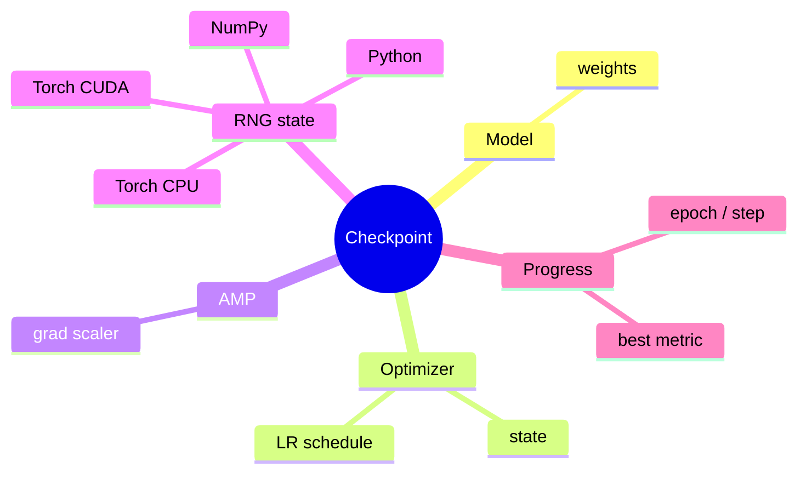
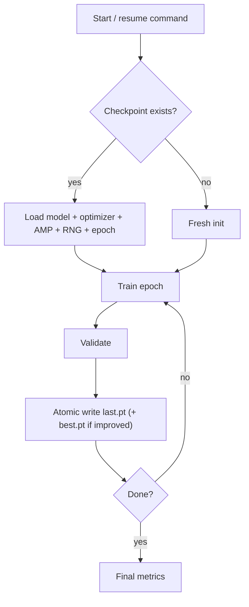
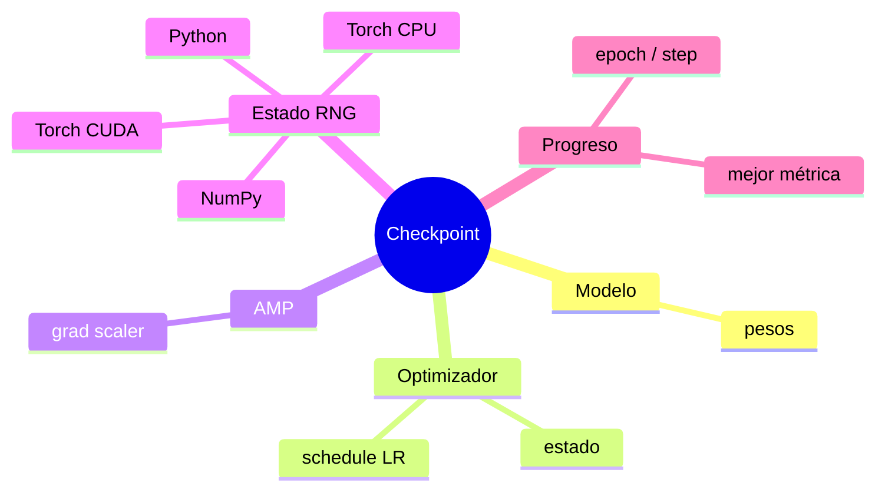
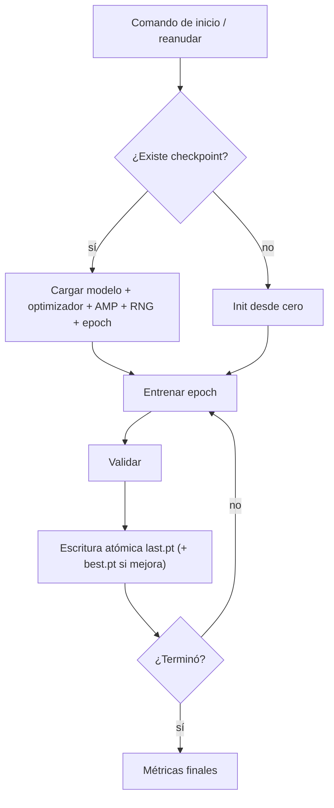

A training run that you cannot resume, cannot reproduce, and whose metrics you cannot fully trust is not an experiment — it is an anecdote. Most of the pain in applied ML is not the modeling; it is the plumbing that makes results **reproducible, resumable, and honest**. Get that right and everything downstream gets easier.

## Checkpoint more than the weights

The classic mistake is saving only the model weights. Resume from that and you silently restart the optimizer, the learning-rate schedule, and the random state — so your "resumed" run is a different experiment. A resumable checkpoint captures the whole training state.

## Make resume the default, and writes atomic

Long runs get interrupted — a preempted GPU, a crash, a full disk. Design so that restarting the exact same command **continues** from the last checkpoint instead of starting over. Two practices make this safe:

- **Atomic writes.** Write `last.pt` and `best.pt` to a temp file and rename into place, so a crash mid-save never leaves a corrupt checkpoint.
- **A stable run identity.** Key each run by `(dataset + architecture + hyperparameters)` so a resume finds *its* checkpoint and never mixes state between experiments.

## Control randomness explicitly

Reproducibility means seeding *and saving* every random source: the language runtime, the array library, and the framework on both CPU and GPU. Save those RNG states in the checkpoint so a resumed run walks the same random path it would have without the interruption. Be explicit about device (CPU vs GPU) and precision (mixed precision changes numerics) — they are part of the result, not incidental.

## Honest metrics beat flattering ones

The most important discipline is refusing to fool yourself. Report the metrics that actually reflect the task, and when you *can't* compute one — for example, when the ground-truth labels for an evaluation split are not public — **return "unavailable" instead of estimating a number that looks good**. An estimated metric presented as real is how teams ship models that quietly underperform in production.

For anything spatial or structured, report a spread of metrics rather than a single headline number, and compute them the standard way (a well-tested library, consistent aggregation) so your results are comparable to published baselines.

## Reproducibility is also a security and cost property

Two side benefits fall out of doing this well. **Explainability:** when a stakeholder asks "why this result?", you can point to the exact code, data snapshot, seed, and config. **Cost control:** if runs are resumable and identity-keyed, you never re-spend GPU hours redoing work an interruption threw away.

None of this is glamorous, and that is the point. The teams whose ML results hold up are not the ones with the fanciest models — they are the ones whose experiments can be re-run tomorrow and land in the same place.

<!--===ES===-->

Un entrenamiento que no puedes reanudar, no puedes reproducir y cuyas métricas no puedes creer del todo no es un experimento: es una anécdota. Casi todo el dolor del ML aplicado no está en el modelado, está en la plomería que hace los resultados **reproducibles, reanudables y honestos**. Acierta eso y todo lo de aguas abajo se vuelve más fácil.

## Guarda más que los pesos

El error clásico es guardar solo los pesos del modelo. Reanuda desde ahí y reinicias en silencio el optimizador, el schedule de learning rate y el estado aleatorio, así que tu corrida "reanudada" es otro experimento. Un checkpoint reanudable captura todo el estado del entrenamiento.

## Haz que reanudar sea el default, y las escrituras atómicas

Las corridas largas se interrumpen: una GPU expropiada, un crash, un disco lleno. Diseña para que reiniciar exactamente el mismo comando **continúe** desde el último checkpoint en vez de empezar de cero. Dos prácticas lo hacen seguro:

- **Escrituras atómicas.** Escribe `last.pt` y `best.pt` a un archivo temporal y renómbralo en su lugar, para que un crash a mitad del guardado nunca deje un checkpoint corrupto.
- **Identidad estable de la corrida.** Identifica cada corrida por `(dataset + arquitectura + hiperparámetros)` para que una reanudación encuentre *su* checkpoint y nunca mezcle estado entre experimentos.

## Controla el azar explícitamente

Reproducibilidad significa fijar la semilla *y guardar* cada fuente de aleatoriedad: el runtime del lenguaje, la librería de arreglos y el framework en CPU y GPU. Guarda esos estados RNG en el checkpoint para que una corrida reanudada siga el mismo camino aleatorio que habría seguido sin la interrupción. Sé explícito con el dispositivo (CPU vs GPU) y la precisión (la precisión mixta cambia los numéricos): son parte del resultado, no un detalle.

## Las métricas honestas le ganan a las halagadoras

La disciplina más importante es negarte a engañarte a ti mismo. Reporta las métricas que de verdad reflejan la tarea, y cuando *no* puedas calcular una —por ejemplo, cuando las etiquetas de un split de evaluación no son públicas— **devuelve "no disponible" en vez de estimar un número que se vea bien**. Una métrica estimada presentada como real es la forma en que los equipos despliegan modelos que rinden por debajo en producción sin que nadie lo note.

Para cualquier cosa espacial o estructurada, reporta un conjunto de métricas en vez de un solo número titular, y calcúlalas de la forma estándar (una librería bien probada, agregación consistente) para que tus resultados sean comparables con las líneas base publicadas.

## La reproducibilidad también es seguridad y costo

Dos beneficios colaterales salen de hacer esto bien. **Explicabilidad:** cuando alguien pregunta "¿por qué este resultado?", puedes señalar el código exacto, el snapshot de datos, la semilla y la config. **Control de costo:** si las corridas son reanudables e identificadas, nunca vuelves a gastar horas de GPU rehaciendo trabajo que una interrupción tiró.

Nada de esto es glamoroso, y ese es el punto. Los equipos cuyos resultados de ML se sostienen no son los del modelo más sofisticado: son aquellos cuyos experimentos pueden re-correrse mañana y caer en el mismo lugar.
